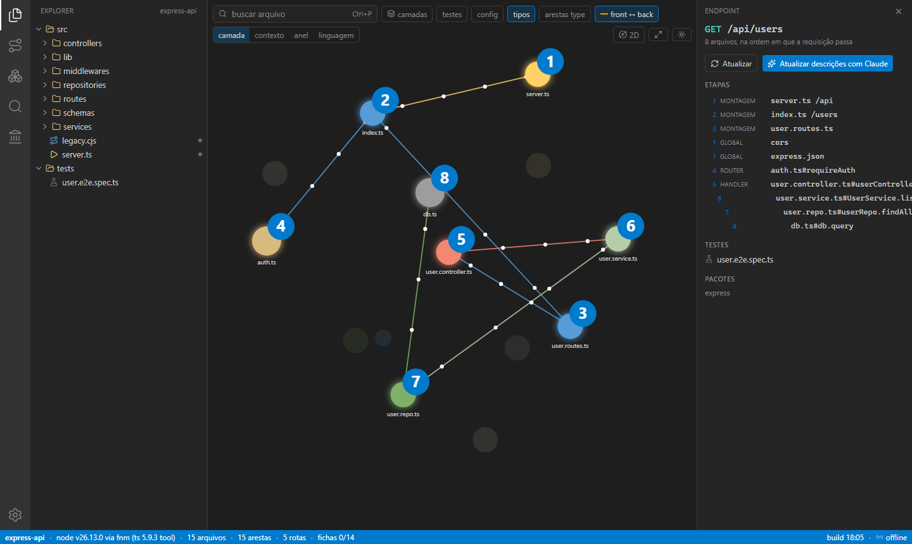
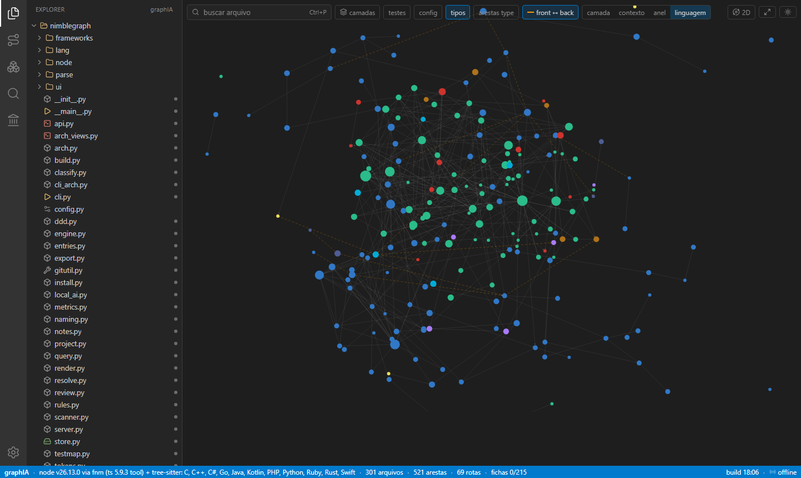

# nimblegraph

**English** | [Português](README.pt-BR.md)

[](https://github.com/HiagoARJ/nimblegraph/actions/workflows/ci.yml)
[](LICENSE)


A dependency graph of your project — JS/TS, Python, Go, Java, Kotlin, C#, PHP, Ruby, Rust, C/C++ and Swift, see
[Languages](#languages) — built so that Claude Code spends fewer tokens. Instead of opening dozens of files to
understand a feature, Claude runs
`nimblegraph analyze user` and gets, in ~500 tokens, the routes, the pages, the front → API → controller → service →
model flow and what each file does (the "notes" Claude writes itself).

```
@analyze user | 11 files | ~344 tok
CHAIN user - Users: sign-up and lookup
ROUTES
 GET,POST /api/users > $c/user.controller.ts
 DELETE,GET /api/users/:id > $c/user.controller.ts
FLOW
 src/routes/index.ts - Root API router
  > src/routes/user.routes.ts - User routes
   > $c/user.controller.ts - Users controller: CRUD; delegates to UserService
    > $s/user.service.ts* - Users service: hashes the password before saving
     > src/repositories/user.repo.ts - Users repository
...
[~344 tok | reading all: ~851 tok | detail 3/3]
```

The same index as a visual graph (`nimblegraph ui`), here with an endpoint lit up in request order:



## Install

Requirements: Python 3.11+. Optional: [Node.js](https://nodejs.org) LTS (faster, more faithful engine built on the
TypeScript compiler) and [Claude Code](https://claude.com/claude-code) (for notes and the `/nimblegraph` skill).

```
pip install git+https://github.com/HiagoARJ/nimblegraph
nimblegraph setup
```

`nimblegraph setup`:
- finds the Node LTS (through [fnm](https://github.com/Schniz/fnm) when present, installing the missing LTS;
  otherwise the `node` on PATH);
- installs `typescript` for the Node engine;
- on Windows, creates `nimblegraph.cmd` (PowerShell/cmd) and `nimblegraph` (Git Bash) in a folder on PATH;
- installs the `/nimblegraph` skill in `~/.claude/skills/nimblegraph/`;
- downloads the tree-sitter grammars of the other languages (otherwise they download on first use).

The UI ships prebuilt. Without Node, JS/TS is parsed by the pure-Python parser, which produces the same output.
The other languages are parsed with [tree-sitter](https://tree-sitter.github.io/); if it cannot load (no wheel
for the platform, a native library blocked by the OS, offline on the first run), a regex fallback still extracts
imports and declarations, and `nimblegraph status` says so.

## Languages

| language | imports resolved through | routes |
|---|---|---|
| JavaScript / TypeScript | tsconfig paths, workspaces, package.json exports/imports, barrels | Express, Fastify, Hono, Koa, Nest, Next.js, React Router, TanStack Router |
| Python | packages and modules (absolute and relative) | FastAPI, Flask, Django (`urls.py`, `include()`), DRF routers |
| Go | `go.mod` module path; identifiers by package | net/http (1.22 patterns), Gin, Echo, Chi, Fiber, gorilla/mux |
| Java | packages, single-type and on-demand imports | Spring MVC/Boot, JAX-RS |
| Kotlin | packages (shared index with Java) | Spring, Ktor |
| C# | namespaces, `using` (also global), `.csproj` | ASP.NET Core controllers, Minimal APIs, Razor Pages |
| PHP | namespaces, `use`, PSR-4 from `composer.json`, require | Laravel, Symfony |
| Ruby | require/require_relative, Rails constant autoloading | Rails routes DSL, Sinatra |
| Rust | the crate's `mod` tree, `use` paths, workspaces | Axum, Actix Web, Rocket |
| C / C++ | `#include` via compile_commands.json, CMake include dirs and a header index; header → implementation | — |
| Swift | SwiftPM targets (module = folder) | Vapor |

For languages that import packages or namespaces instead of files (Go, Java, Kotlin, C#, PHP, Swift, Ruby
constants), the file-to-file edges come from the identifiers a file references, resolved through a project-wide
index of declarations. Layers (controller, service, repository, model...) come from framework annotations and
from name/folder conventions; `nimblegraph tests` prints the run command of each ecosystem (`pytest`, `go test`,
`mvn`/`gradle`, `dotnet test`, `phpunit`, `rspec`, `cargo test`, `ctest`, `swift test`).

Route prefixes and URLs are evaluated: string constants (also from other files, like `settings.API_V1_STR`),
Spring `${...}` properties, interpolations, concatenations and format calls. HTTP calls are linked to the
routes they reach in every language, from clients (HttpClient, requests, RestTemplate, net/http, Guzzle...)
and from tests (TestClient, MockMvc, httptest, request specs, `getJson`), so a front end or a service in one
language and a back end in another are connected, and those tests count as end-to-end for `nimblegraph tests`.

In a project:

```
cd my-project
nimblegraph init --claude-md      # .nimblegraph/, graph.db in .gitignore, a section in CLAUDE.md
nimblegraph analyze user
nimblegraph ui                    # visual graph in the browser, updated live
```

## Commands

| command | returns |
|---|---|
| `nimblegraph analyze <term>` | the feature chain: routes, pages, front ↔ back flow, shared files, files without notes |
| `nimblegraph endpoint "<METHOD /route>" [--files]` | an endpoint's files in request order: mounts, middlewares, validation, handler, what the handler uses (per method), front-end callers, tests |
| `nimblegraph flow <route\|page\|file>` | end-to-end chain |
| `nimblegraph file <file>` | note, exports, imports, importers, routes, API calls |
| `nimblegraph deps` / `nimblegraph rdeps <file>` | tree of what it uses / who uses it |
| `nimblegraph routes [filter]` | all routes and pages |
| `nimblegraph find <text>` | paths, symbols, routes and notes |
| `nimblegraph impact <files> \| --git` | affected pages, routes, callers and tests |
| `nimblegraph cycles` / `nimblegraph orphans` / `nimblegraph entries` | import cycles / files nobody uses / entry points |
| `nimblegraph status` | engine, layers, routes, note coverage, unresolved imports |
| `nimblegraph todo` | files without a note or with a stale note, most important first |
| `nimblegraph update [target] [--ai]` | what changed and the batch of notes to rewrite; `--ai` calls Claude Code (`claude -p`) to write them |
| `nimblegraph describe ...` | writes notes: `<file> --title .. --summary ..`, `--symbol`, `--chain`, `--json '[...]'`, `--batch <file\|->` |
| `nimblegraph export --format mermaid\|dot\|json [target]` | diagram |
| `nimblegraph ui [--port 4777] [--no-open] [--dev]` | visual interface |
| `nimblegraph build [--full]` / `nimblegraph setup` | index / install |
| `nimblegraph init [--claude-md] [--hook] [--guard]` | creates `.nimblegraph/`; `--claude-md` adds the CLAUDE.md section, `--hook` rebuilds the index after every Edit/Write in Claude Code, `--guard` reports new architecture violations after every Edit/Write |

Governance (details in [Architecture governance](#architecture-governance)):

| command | returns |
|---|---|
| `nimblegraph check [files] [--git\|--base REF] [--all] [--baseline] [--format text\|json\|markdown\|github]` | new architecture-rule violations (exits 1 on a new error) |
| `nimblegraph rules [--init [presets]] [--export depcruise]` | presets and active rules; writes `.nimblegraph/rules.toml` |
| `nimblegraph ddd [context]` | bounded contexts, aggregates, tactical blocks, context map, leaks |
| `nimblegraph glossary [--init]` | ubiquitous language: domain terms per context, synonyms, `glossary.toml` |
| `nimblegraph conventions` | naming conventions per package+layer and the files that break them |
| `nimblegraph architecture [--by ...] [--dsm] [--format mermaid]` | Ca, Ce, instability, abstractness and distance per module; "god" files; dependency matrix |
| `nimblegraph hotspots [--months 6]` | files that change a lot × size × coupling (git log) |
| `nimblegraph trend` | history recorded by `nimblegraph check --record` |
| `nimblegraph adr` | ADRs and the files each applies to (`Applies-to:`) |
| `nimblegraph deadcode` | exports nobody imports and orphan files |
| `nimblegraph tests [files\|--git]` | structural coverage (endpoints, use cases, aggregates, pages); with files: the tests to run and the command |
| `nimblegraph contracts` | front-end calls without a route, with the wrong method, routes without callers |
| `nimblegraph review [--base REF] [--format markdown]` | PR report: violations, impact, tests, ADRs, notes, reviewers (CODEOWNERS) |

Common options: `--budget N` (tokens, default 1500), `--depth N`, `--root <dir>`, `--engine auto|node|python`.
When an answer exceeds the budget it is reduced in steps:
1. drop symbol lists;
2. reduce notes to their title;
3. replace deep levels with counts;
4. cut and suggest the next command.

## Notes

They live in `.nimblegraph/notes.json`, which should be committed. `graph.db` is a cache and can be rebuilt any time.

- **File notes**: `title` (≤12 tok), `summary` (≤40), `resp` (≤30), `scope` (≤12), `flow` (≤40), `tags` (≤6). There
  are also per-symbol notes (`file#Symbol`).
- **Chain notes**: `title` (≤12), `summary` (≤60), `flow` (≤80), plus the chain's files and their hashes.
- **Staleness**: a file note becomes stale (`*`) when the file's hash changes. A chain note, when one of its files
  changes, enters or leaves.
- **Language**: notes are written in Brazilian Portuguese by default; set `notes_language` in
  `.nimblegraph/config.toml` (e.g. `notes_language = "English"`).

## Notes with a local AI (Hugging Face, no cloud)

Notes can also be written by a Hugging Face model running on your machine. Neither Claude nor any other cloud AI is
needed. nimblegraph talks over HTTP to a local server:
- **Ollama:** detected automatically; uses the native API with a JSON schema.
- **LM Studio or llama-server:** used through the OpenAI-compatible API.

nimblegraph only uses the Python standard library: no `torch` and no native DLLs (handy on Windows with Smart App
Control, which blocks unsigned DLLs).

```
winget install Ollama.Ollama     # or https://ollama.com/download
nimblegraph local setup                # downloads the model from Hugging Face and describes a test file
nimblegraph local describe --all       # describes every file without a note (resumable: Ctrl+C and run again)
nimblegraph local describe user        # only one term's chain (+ the chain note)
nimblegraph update "GET /api/users" --local
```

- **Default model:** `hf.co/unsloth/Qwen3-Coder-30B-A3B-Instruct-GGUF:UD-Q3_K_XL`, a 30B MoE with 3B active
  parameters per token, about 13.8 GB. With little video memory, pick a smaller model in `model`.
- **Integrated GPU:** for Ollama with Vulkan (e.g. Intel Arc), set `OLLAMA_IGPU_ENABLE=1` and `OLLAMA_VULKAN=1`.
- **Configuration:** in `.nimblegraph/config.toml`:
  ```toml
  [local_ai]
  url = "http://127.0.0.1:11434"   # LM Studio: http://127.0.0.1:1234  | llama-server: http://127.0.0.1:8080
  model = "hf.co/unsloth/Qwen3-Coder-30B-A3B-Instruct-GGUF:UD-Q3_K_XL"
  context = 8192                   # context tokens on the server
  max_file_tokens = 3000           # code sent per file (start of large files)
  ```
- **What the model gets:** the file's code and graph context (layer, routes, exports, imports, importers, API calls,
  notes of what it imports).
- **What it returns:** JSON in the notes format, trimmed to the token limits.
- **Marking:** notes written this way carry `"by": "local:<model>"`. When Claude rewrites one, the mark goes away.
- **In the UI:** when the server and model are ready, the panel shows a "Describe with local AI" button and the
  progress appears in the status bar.

## Architecture governance

The same index becomes executable rules. With no configuration, `nimblegraph check` detects the architecture and applies
the presets that fit; `nimblegraph rules --init` writes `.nimblegraph/rules.toml` (committed) to pin them and add your own.

| preset | guarantees |
|---|---|
| `layered` | controller → service → repository → model, no file cycles |
| `nest` | `layered` + modules talk through their public API (what `@Module` exports, index, DTOs) |
| `clean` / `hexagonal` | domain ← application ← infrastructure/presentation; domain without framework, ORM or HTTP |
| `ddd` | `clean` + bounded contexts: public API, aggregate boundary, no entity from another context, no cycles between contexts |
| `react` | components fetch data through a hook/store, pages don't import pages |
| `deps` | duplicate libraries for the same job; diverging versions in a workspace |
| `naming` | file, class, folder and route conventions (inferred from the project or from `[naming]`) and glossary synonyms |
| `fullstack` | front-end calls match back-end routes (path and method) |

```toml
extends = ["ddd", "react", "deps", "naming", "fullstack"]
disable = ["layered/controller-no-model"]

[severity]
"naming/file-case" = "info"

[contexts]                      # when folders don't say it on their own
billing = ["src/billing/**"]

[naming]
files = "kebab"
[naming.layers.service]
file = "*.service.ts"
class = "*Service"

[tests]
require_test_for = ["route:api", "role:use-case"]

[[rules]]
name = "web never imports the server"
kind = "deny"                   # deny, allow-only, deny-external, no-cycles, public-api, aggregate-boundary,
from = { path = "apps/web/**" } # max-deps, max-importers, max-loc, duplicate-libs, version-drift, ...
to = { path = "apps/server/**" }
severity = "error"
adr = "0003"
```

Selectors: `layer`, `path` (glob), `context` (`$same`, `$other`, `*`), `ring` (domain/application/infrastructure/
presentation), `role` (aggregate, entity, value-object, domain-event, command, query, *-handler, use-case, port,
adapter, repository, controller...), `pkg`, `public`, `not`.

- **Baseline (ratchet):** `nimblegraph check --baseline` accepts the current state in `.nimblegraph/baseline.json`. From
  then on only new violations fail, and the ones that disappear show as `RESOLVED`.
- **Guard in Claude Code:** `nimblegraph init --guard` installs a PostToolUse hook (`nimblegraph check --hook`). If an edit
  breaks a rule, Claude gets the message right away and fixes it.
- **ADRs:** an `Applies-to: src/modules/*/domain/**` line in an ADR links the decision to files (`nimblegraph adr`, `review`).
- **CI (GitHub Actions):**
  ```yaml
  - run: pip install git+https://github.com/HiagoARJ/nimblegraph && nimblegraph build
  - run: nimblegraph check --format github --record        # PR annotations + history (nimblegraph trend)
  - run: nimblegraph review --base origin/main --format markdown >> $GITHUB_STEP_SUMMARY
  ```

## Interface (`nimblegraph ui`)

React 19, Vite, Tailwind v4, lucide-react, zustand and react-force-graph, in VS Code style.



- **Sidebar**: Explorer revealing the selected file in the tree, Routes, Features (chains and scopes), Search and
  Architecture (violations, contexts and aggregates, I/A/D metrics, untested endpoints).
- **Colors**: by layer, by bounded context, by ring (domain, application, infrastructure, presentation) or by
  language.
- **Animated graph**: particles run in the direction of dependencies; API calls show as dashed orange lines.
- **Hover and click**: hovering lights up the whole chain; clicking pins the selection, frames the chain and opens the
  panel with the note, the chain, the imports and the token cost.
- **Routes**: clicking a route lights up the endpoint with steps numbered in request order.
- **Shortcuts**: `Ctrl+P` opens Quick Open, `Ctrl+Shift+F` search and `Esc` clears the selection. Light theme and
  3D mode available.
- **Live updates**: the graph refreshes itself when you edit code or when Claude writes notes.
- **Panel buttons**: "Refresh" and "Update descriptions with Claude". Without Claude Code installed, the second
  button copies `/nimblegraph update <target>`.
- **Deep links**: `?select=<file>`, `?endpoint=POST%20/api/x`, `?view=routes|architecture`, `?color=context|ring|lang`,
  `?theme=light`.

## How it works

- **Node engine** (`nimblegraph/node/extract.mjs`): uses the TypeScript compiler API to parse each file and resolves
  imports with `ts.resolveModuleName` against the real tsconfig (`paths`, `extends`, `references`). One process per
  build. The Python engine (`nimblegraph/parse/`) is used when there is no Node and produces the same output; a parity
  test guarantees it.
- **Post-pass** (`resolve.py`): monorepo workspaces (`dist/` → `src/`), `package.json` `#imports`, `vite.config`
  aliases and barrels.
- **Other languages** (`nimblegraph/lang/`): a registry of languages (extensions, manifests, build folders, test
  patterns), one tree-sitter extractor per language that produces the same per-file record as the JS engines, a
  regex fallback, manifest readers (`go.mod`, `pom.xml`, Gradle, `.csproj`, `composer.json`, `Gemfile`,
  `Cargo.toml`, `pyproject.toml`, `Package.swift`, CMake) and the resolvers described in [Languages](#languages).
- **Frameworks** (`nimblegraph/frameworks/`): detect routes, mounts with prefixes across files, middlewares, guards and
  DTOs, and match front-end `fetch`/axios calls to back-end routes.
- **Symbol references**: link down to the method (`users.create` → `UserService.create`), following `new X()`,
  objects with methods and constructor injection.
- **Incremental build**: only changed files are parsed again.
- **Environment variables**: `NIMBLEGRAPH_INDEX_DIR` stores the index outside the project (used by the tests).

## Roadmap

See [ROADMAP.md](ROADMAP.md) for what each language supports and what comes next, and
[CHANGELOG.md](CHANGELOG.md) for what changed in each version.

## Development

```
git clone https://github.com/HiagoARJ/nimblegraph && cd nimblegraph
pip install -e .[dev]
nimblegraph setup
python -m pytest -q                       # tests (fixtures in tests/fixtures)
nimblegraph ui --dev                            # Vite dev server proxying to the Python API
cd nimblegraph/ui && npm run build          # UI build (tsc + vite)
```

See [CONTRIBUTING.md](CONTRIBUTING.md). To report a vulnerability, see [SECURITY.md](SECURITY.md).

## License

[MIT](LICENSE)
