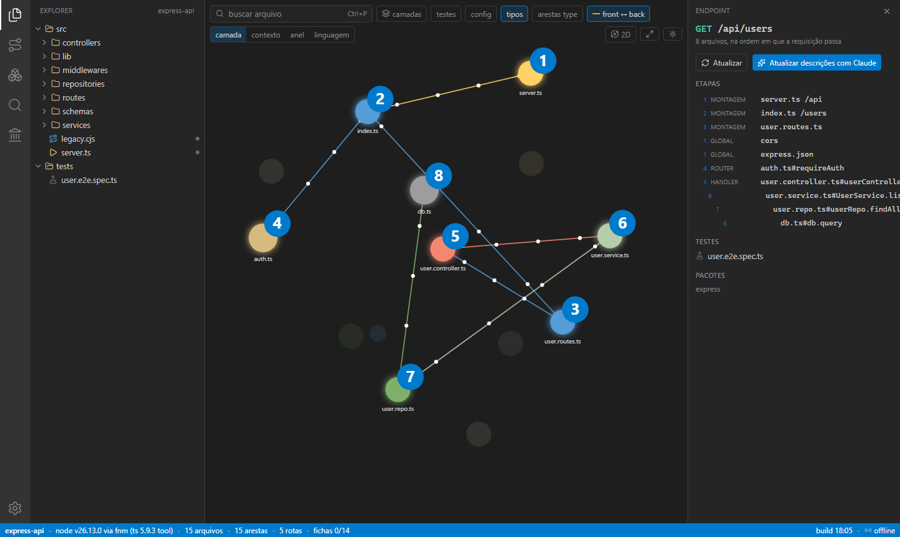
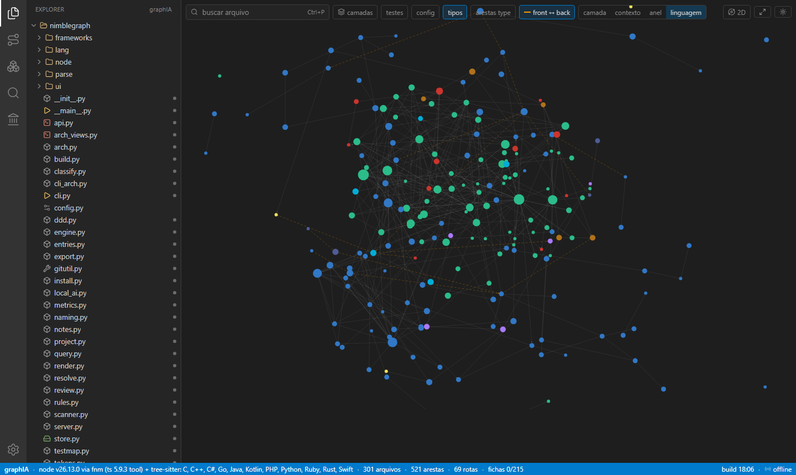

# nimblegraph

[English](README.md) | **Português**

[](https://github.com/HiagoARJ/nimblegraph/actions/workflows/ci.yml)
[](LICENSE)


Grafo de dependências do seu projeto — JS/TS, Python, Go, Java, Kotlin, C#, PHP, Ruby, Rust, C/C++ e Swift, veja
[Linguagens](#linguagens) — feito para o Claude Code gastar menos tokens. Em vez de abrir dezenas de arquivos para
entender uma funcionalidade, o Claude
roda `nimblegraph analyze user` e recebe, em ~500 tokens, as rotas, as páginas, o fluxo front → API → controller →
service → model e o que cada arquivo faz (as "fichas" que ele mesmo escreve).

```
@analyze user | 11 files | ~344 tok
CHAIN user - Usuários: Cadastro e consulta de usuários
ROUTES
 GET,POST /api/users > $c/user.controller.ts
 DELETE,GET /api/users/:id > $c/user.controller.ts
FLOW
 src/routes/index.ts - Roteador raiz da API
  > src/routes/user.routes.ts - Rotas de usuário
   > $c/user.controller.ts - Controller de usuários: CRUD; delega ao UserService
    > $s/user.service.ts* - Serviço de usuários: hash de senha antes de gravar
     > src/repositories/user.repo.ts - Repositório de usuários
...
[~344 tok | reading all: ~851 tok | detail 3/3]
```

O mesmo índice como grafo visual (`nimblegraph ui`), aqui com um endpoint aceso na ordem da requisição:



## Instalação

Requisitos: Python 3.11+. Opcionais: [Node.js](https://nodejs.org) LTS (motor mais rápido e fiel, usando o
compilador TypeScript) e o [Claude Code](https://claude.com/claude-code) (para as fichas e a skill `/nimblegraph`).

```
pip install git+https://github.com/HiagoARJ/nimblegraph
nimblegraph setup
```

`nimblegraph setup`:
- acha a Node LTS (pelo [fnm](https://github.com/Schniz/fnm), se houver, instalando a LTS que faltar; senão, a
  `node` do PATH);
- instala o `typescript` do motor Node;
- cria `nimblegraph.cmd` (PowerShell/cmd) e `nimblegraph` (Git Bash) numa pasta do PATH, no Windows;
- instala a skill `/nimblegraph` em `~/.claude/skills/nimblegraph/`;
- baixa as gramáticas tree-sitter das outras linguagens (senão, elas baixam no primeiro uso).

A interface já vem compilada. Sem Node, o JS/TS é lido pelo parser em Python puro, que produz a mesma saída. As
outras linguagens são lidas com o [tree-sitter](https://tree-sitter.github.io/); se ele não carregar (sem wheel
para a plataforma, biblioteca nativa bloqueada pelo sistema, offline na primeira vez), um fallback por regex ainda
extrai imports e declarações, e o `nimblegraph status` avisa.

## Linguagens

| linguagem | imports resolvidos por | rotas |
|---|---|---|
| JavaScript / TypeScript | paths do tsconfig, workspaces, exports/imports do package.json, barrels | Express, Fastify, Hono, Koa, Nest, Next.js, React Router, TanStack Router |
| Python | pacotes e módulos (absolutos e relativos) | FastAPI, Flask, Django (`urls.py`, `include()`), routers do DRF |
| Go | module path do `go.mod`; identificadores por pacote | net/http (padrões do 1.22), Gin, Echo, Chi, Fiber, gorilla/mux |
| Java | pacotes, imports de tipo e sob demanda | Spring MVC/Boot, JAX-RS |
| Kotlin | pacotes (índice compartilhado com Java) | Spring, Ktor |
| C# | namespaces, `using` (inclusive global), `.csproj` | controllers do ASP.NET Core, Minimal APIs, Razor Pages |
| PHP | namespaces, `use`, PSR-4 do `composer.json`, require | Laravel, Symfony |
| Ruby | require/require_relative, autoload de constantes do Rails | DSL de rotas do Rails, Sinatra |
| Rust | árvore de `mod` do crate, caminhos de `use`, workspaces | Axum, Actix Web, Rocket |
| C / C++ | `#include` via compile_commands.json, include dirs do CMake e índice de headers; header → implementação | — |
| Swift | targets do SwiftPM (módulo = pasta) | Vapor |

Nas linguagens que importam pacotes ou namespaces em vez de arquivos (Go, Java, Kotlin, C#, PHP, Swift,
constantes do Ruby), as arestas entre arquivos vêm dos identificadores que o arquivo referencia, resolvidos por um
índice de declarações do projeto inteiro. As camadas (controller, service, repository, model...) vêm das
anotações dos frameworks e das convenções de nome e pasta; o `nimblegraph tests` mostra o comando de cada ecossistema
(`pytest`, `go test`, `mvn`/`gradle`, `dotnet test`, `phpunit`, `rspec`, `cargo test`, `ctest`, `swift test`).

Prefixos de rota e URLs são avaliados: constantes de string (inclusive de outros arquivos, como
`settings.API_V1_STR`), propriedades `${...}` do Spring, interpolações, concatenações e chamadas de formatação.
As chamadas HTTP de todas as linguagens se ligam às rotas que alcançam, vindas de clientes (HttpClient,
requests, RestTemplate, net/http, Guzzle...) e de testes (TestClient, MockMvc, httptest, request specs,
`getJson`): front-end ou serviço numa linguagem e back-end em outra ficam conectados, e esses testes contam
como ponta a ponta no `nimblegraph tests`.

Num projeto:

```
cd meu-projeto
nimblegraph init --claude-md      # .nimblegraph/, graph.db no .gitignore, seção no CLAUDE.md
nimblegraph analyze user
nimblegraph ui                    # grafo visual no navegador, atualizado ao vivo
```

## Comandos

| comando | o que retorna |
|---|---|
| `nimblegraph analyze <termo>` | a cadeia da funcionalidade: rotas, páginas, fluxo front ↔ back, compartilhados, arquivos sem ficha |
| `nimblegraph endpoint "<MÉTODO /rota>" [--files]` | os arquivos de um endpoint na ordem da requisição: montagem, middlewares, validação, handler, o que o handler usa (por método), chamadas do front, testes |
| `nimblegraph flow <rota\|página\|arquivo>` | cadeia ponta a ponta |
| `nimblegraph file <arquivo>` | ficha, exports, imports, quem importa, rotas, chamadas de API |
| `nimblegraph deps` / `nimblegraph rdeps <arquivo>` | árvore do que usa / de quem usa |
| `nimblegraph routes [filtro]` | todas as rotas e páginas |
| `nimblegraph find <texto>` | caminhos, símbolos, rotas e fichas |
| `nimblegraph impact <arquivos> \| --git` | páginas, rotas, chamadores e testes afetados |
| `nimblegraph cycles` / `nimblegraph orphans` / `nimblegraph entries` | ciclos de import / arquivos que ninguém usa / pontos de entrada |
| `nimblegraph status` | motor, camadas, rotas, cobertura de fichas, imports não resolvidos |
| `nimblegraph todo` | arquivos sem ficha ou com ficha desatualizada, os mais importantes primeiro |
| `nimblegraph update [alvo] [--ai]` | o que mudou e o lote de fichas a reescrever; `--ai` chama o Claude Code (`claude -p`) para escrevê-las |
| `nimblegraph describe ...` | grava fichas: `<arquivo> --title .. --summary ..`, `--symbol`, `--chain`, `--json '[...]'`, `--batch <arquivo\|->` |
| `nimblegraph export --format mermaid\|dot\|json [alvo]` | diagrama |
| `nimblegraph ui [--port 4777] [--no-open] [--dev]` | interface visual |
| `nimblegraph build [--full]` / `nimblegraph setup` | índice / instalação |
| `nimblegraph init [--claude-md] [--hook] [--guard]` | cria `.nimblegraph/`; `--claude-md` acrescenta a seção no CLAUDE.md, `--hook` refaz o índice depois de cada Edit/Write no Claude Code, `--guard` avisa das violações de arquitetura novas depois de cada Edit/Write |

Governança (detalhes em [Governança de arquitetura](#governança-de-arquitetura)):

| comando | o que retorna |
|---|---|
| `nimblegraph check [arquivos] [--git\|--base REF] [--all] [--baseline] [--format text\|json\|markdown\|github]` | violações novas das regras de arquitetura (sai com 1 se houver erro novo) |
| `nimblegraph rules [--init [presets]] [--export depcruise]` | presets e regras ativas; grava `.nimblegraph/rules.toml` |
| `nimblegraph ddd [contexto]` | contextos delimitados, agregados, blocos táticos, mapa de contextos, vazamentos |
| `nimblegraph glossary [--init]` | linguagem ubíqua: termos do domínio por contexto, sinônimos, `glossary.toml` |
| `nimblegraph conventions` | convenções de nomenclatura por pacote+camada e os arquivos fora delas |
| `nimblegraph architecture [--by ...] [--dsm] [--format mermaid]` | Ca, Ce, instabilidade, abstração e distância por módulo; arquivos "deus"; matriz de dependências |
| `nimblegraph hotspots [--months 6]` | arquivos que mudam muito × tamanho × acoplamento (git log) |
| `nimblegraph trend` | histórico gravado por `nimblegraph check --record` |
| `nimblegraph adr` | ADRs e os arquivos a que cada uma se aplica (`Applies-to:`) |
| `nimblegraph deadcode` | exports que ninguém importa e arquivos órfãos |
| `nimblegraph tests [arquivos\|--git]` | cobertura estrutural (endpoints, casos de uso, agregados, páginas); com arquivos: os testes a rodar e o comando |
| `nimblegraph contracts` | chamadas do front sem rota, com método errado, rotas sem chamador |
| `nimblegraph review [--base REF] [--format markdown]` | relatório de PR: violações, impacto, testes, ADRs, fichas, revisores (CODEOWNERS) |

Opções comuns: `--budget N` (tokens, padrão 1500), `--depth N`, `--root <pasta>`, `--engine auto|node|python`.
Quando uma resposta passa do budget, ela é reduzida em etapas:
1. tira as listas de símbolos;
2. reduz as fichas ao título;
3. troca níveis profundos por contagens;
4. corta e sugere o próximo comando.

## Fichas

Ficam em `.nimblegraph/notes.json`, que deve ir para o git. O `graph.db` é cache e é refeito a qualquer momento.

- **De arquivo**: `title` (≤12 tok), `summary` (≤40), `resp` (≤30), `scope` (≤12), `flow` (≤40), `tags` (≤6). Também
  existem por símbolo (`arquivo#Simbolo`).
- **De cadeia**: `title` (≤12), `summary` (≤60), `flow` (≤80), mais os arquivos da cadeia e os hashes deles.
- **Desatualização**: a ficha de arquivo fica desatualizada (`*`) quando o hash do arquivo muda. A de cadeia,
  quando um arquivo dela muda, entra ou sai.
- **Idioma**: as fichas saem em português do Brasil por padrão; mude com `notes_language` no
  `.nimblegraph/config.toml` (ex.: `notes_language = "English"`).

## Fichas com IA local (Hugging Face, sem nuvem)

As fichas também podem ser escritas por um modelo do Hugging Face rodando na sua máquina. Não é preciso Claude nem
nenhuma outra IA na nuvem. O nimblegraph conversa por HTTP com um servidor local:
- **Ollama:** detectado automaticamente; usa a API nativa com JSON schema.
- **LM Studio ou llama-server:** usados pela API compatível com a OpenAI.

O nimblegraph usa só a biblioteca padrão do Python, sem `torch` nem DLLs nativas (útil no Windows com o Smart App
Control, que bloqueia DLLs sem assinatura).

```
winget install Ollama.Ollama     # ou https://ollama.com/download
nimblegraph local setup                # baixa o modelo do Hugging Face e descreve um arquivo de teste
nimblegraph local describe --all       # descreve todos os arquivos sem ficha (retomável: Ctrl+C e rode de novo)
nimblegraph local describe user        # só a cadeia de um termo (+ a ficha de cadeia)
nimblegraph update "GET /api/users" --local
```

- **Modelo padrão:** `hf.co/unsloth/Qwen3-Coder-30B-A3B-Instruct-GGUF:UD-Q3_K_XL`. É um MoE de 30B com 3B ativos
  por token e ocupa cerca de 13,8 GB. Com pouca memória de vídeo, troque por um modelo menor em `model`.
- **GPU integrada:** no Ollama com Vulkan (ex.: Intel Arc), defina `OLLAMA_IGPU_ENABLE=1` e `OLLAMA_VULKAN=1`.
- **Configuração:** fica em `.nimblegraph/config.toml`:
  ```toml
  [local_ai]
  url = "http://127.0.0.1:11434"   # LM Studio: http://127.0.0.1:1234  | llama-server: http://127.0.0.1:8080
  model = "hf.co/unsloth/Qwen3-Coder-30B-A3B-Instruct-GGUF:UD-Q3_K_XL"
  context = 8192                   # tokens de contexto no servidor
  max_file_tokens = 3000           # código enviado por arquivo (início dos arquivos grandes)
  ```
- **O que o modelo recebe:** o código do arquivo e o contexto do grafo (camada, rotas, exports, imports, quem usa,
  chamadas de API, fichas do que ele importa).
- **O que ele devolve:** um JSON no formato das fichas, ajustado aos limites de tokens.
- **Marcação:** as fichas geradas assim levam `"by": "local:<modelo>"`. Quando o Claude reescreve uma, a marca sai.
- **Na interface:** quando o servidor e o modelo estão prontos, o painel mostra o botão "Descrever com IA local",
  e o progresso aparece na barra de status.

## Governança de arquitetura

O mesmo índice vira regra executável. Sem configuração, `nimblegraph check` detecta a arquitetura e aplica os presets que
cabem; `nimblegraph rules --init` grava `.nimblegraph/rules.toml` (versionado) para fixá-los e acrescentar regras próprias.

| preset | o que garante |
|---|---|
| `layered` | controller → service → repository → model, sem ciclos de arquivo |
| `nest` | `layered` + módulos se falam pela API pública (o que o `@Module` exporta, index, DTOs) |
| `clean` / `hexagonal` | domínio ← aplicação ← infraestrutura/apresentação; domínio sem framework, ORM nem HTTP |
| `ddd` | `clean` + contextos delimitados: API pública, fronteira de agregado, sem entidade de outro contexto, sem ciclo entre contextos |
| `react` | componente busca dados por hook/store, página não importa página |
| `deps` | bibliotecas duplicadas para a mesma função; versões divergentes num workspace |
| `naming` | convenções de arquivo, classe, pasta e rota (inferidas do projeto ou do `[naming]`) e sinônimos do glossário |
| `fullstack` | chamadas do front batem com as rotas do back (caminho e método) |

```toml
extends = ["ddd", "react", "deps", "naming", "fullstack"]
disable = ["layered/controller-no-model"]

[severity]
"naming/file-case" = "info"

[contexts]                      # quando as pastas não dizem sozinhas
billing = ["src/billing/**"]

[naming]
files = "kebab"
[naming.layers.service]
file = "*.service.ts"
class = "*Service"

[tests]
require_test_for = ["route:api", "role:use-case"]

[[rules]]
name = "web nunca importa o server"
kind = "deny"                   # deny, allow-only, deny-external, no-cycles, public-api, aggregate-boundary,
from = { path = "apps/web/**" } # max-deps, max-importers, max-loc, duplicate-libs, version-drift, ...
to = { path = "apps/server/**" }
severity = "error"
adr = "0003"
```

Seletores: `layer`, `path` (glob), `context` (`$same`, `$other`, `*`), `ring` (domain/application/infrastructure/
presentation), `role` (aggregate, entity, value-object, domain-event, command, query, *-handler, use-case, port,
adapter, repository, controller...), `pkg`, `public`, `not`.

- **Baseline (catraca):** `nimblegraph check --baseline` aceita o estado atual em `.nimblegraph/baseline.json`. Daí em
  diante, só violações novas falham, e as que somem aparecem como `RESOLVED`.
- **Guarda no Claude Code:** `nimblegraph init --guard` instala um hook PostToolUse (`nimblegraph check --hook`). Se uma edição
  quebrar uma regra, o Claude recebe a mensagem na hora e corrige.
- **ADRs:** uma linha `Applies-to: src/modules/*/domain/**` numa ADR liga a decisão aos arquivos (`nimblegraph adr`, `review`).
- **CI (GitHub Actions):**
  ```yaml
  - run: pip install git+https://github.com/HiagoARJ/nimblegraph && nimblegraph build
  - run: nimblegraph check --format github --record        # anotações no PR + histórico (nimblegraph trend)
  - run: nimblegraph review --base origin/main --format markdown >> $GITHUB_STEP_SUMMARY
  ```

## Interface (`nimblegraph ui`)

React 19, Vite, Tailwind v4, lucide-react, zustand e react-force-graph, no estilo do VS Code.



- **Barra lateral**: Explorer com o arquivo selecionado revelado na árvore, Rotas, Features (cadeias e escopos), Busca e
  Arquitetura (violações, contextos e agregados, métricas I/A/D, endpoints sem teste).
- **Cores**: por camada, por contexto delimitado, por anel (domínio, aplicação, infraestrutura, apresentação) ou por
  linguagem.
- **Grafo animado**: partículas correm no sentido das dependências; as chamadas de API aparecem tracejadas em laranja.
- **Hover e clique**: passar o mouse acende a cadeia inteira; clicar fixa a seleção, enquadra a cadeia e abre o
  painel com a ficha, a cadeia, os imports e o custo em tokens.
- **Rotas**: clicar numa rota acende o endpoint com as etapas numeradas na ordem da requisição.
- **Atalhos**: `Ctrl+P` abre o Quick Open, `Ctrl+Shift+F` a busca e `Esc` limpa a seleção. Há tema claro e modo 3D.
- **Atualização ao vivo**: o grafo se atualiza sozinho quando você edita o código ou quando o Claude grava fichas.
- **Botões do painel**: "Atualizar" e "Atualizar descrições com Claude". Sem Claude Code instalado, o segundo
  botão copia `/nimblegraph update <alvo>`.
- **Links diretos**: `?select=<arquivo>`, `?endpoint=POST%20/api/x`, `?view=routes|architecture`, `?color=context|ring|lang`,
  `?theme=light`.

## Como funciona

- **Motor Node** (`nimblegraph/node/extract.mjs`): usa a API do compilador TypeScript para fazer o parse de cada
  arquivo e resolve os imports com `ts.resolveModuleName` no tsconfig real (`paths`, `extends`, `references`).
  Roda num único processo por build. O motor Python (`nimblegraph/parse/`) é usado quando não há Node e produz
  a mesma saída; um teste de paridade garante isso.
- **Pós-passo** (`resolve.py`): trata workspaces de monorepo (`dist/` → `src/`), `#imports` do `package.json`,
  aliases do `vite.config` e barrels.
- **Outras linguagens** (`nimblegraph/lang/`): registro de linguagens (extensões, manifestos, pastas de build,
  padrões de teste), um extrator tree-sitter por linguagem que produz o mesmo registro por arquivo dos motores JS,
  fallback por regex, leitores de manifesto (`go.mod`, `pom.xml`, Gradle, `.csproj`, `composer.json`, `Gemfile`,
  `Cargo.toml`, `pyproject.toml`, `Package.swift`, CMake) e os resolvedores descritos em [Linguagens](#linguagens).
- **Frameworks** (`nimblegraph/frameworks/`): detectam rotas, montagens com prefixos entre arquivos, middlewares,
  guards e DTOs, e casam as chamadas `fetch`/axios do front com as rotas do backend.
- **Referências por símbolo**: ligam até o método (`users.create` → `UserService.create`), seguindo `new X()`,
  objetos com métodos e injeção pelo construtor.
- **Build incremental**: só os arquivos alterados passam por parse de novo.
- **Variáveis de ambiente**: `NIMBLEGRAPH_INDEX_DIR` guarda o índice fora do projeto (usado nos testes).

## Roteiro

Veja no [ROADMAP.md](ROADMAP.md) o que cada linguagem suporta e o que vem a seguir, e no
[CHANGELOG.md](CHANGELOG.md) o que mudou em cada versão.

## Desenvolvimento

```
git clone https://github.com/HiagoARJ/nimblegraph && cd nimblegraph
pip install -e .[dev]
nimblegraph setup
python -m pytest -q                       # testes (fixtures em tests/fixtures)
nimblegraph ui --dev                            # Vite dev server com proxy para a API Python
cd nimblegraph/ui && npm run build          # build da UI (tsc + vite)
```

Veja [CONTRIBUTING.md](CONTRIBUTING.md). Para relatar uma vulnerabilidade, veja [SECURITY.md](SECURITY.md).

## Licença

[MIT](LICENSE)
